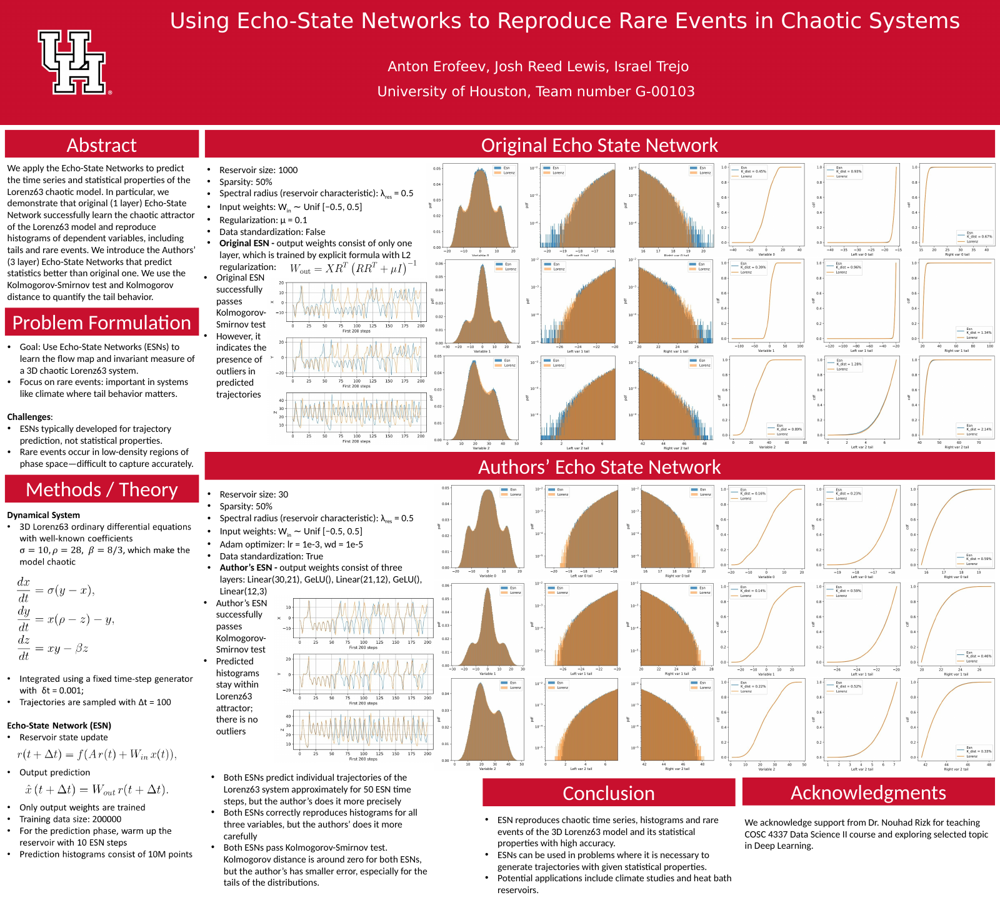

# Reproducing Rare Events in a Chaotic System with Echo State Networks

Can a small, cheap recurrent model learn a chaotic system well enough to reproduce its *extreme events*, not just its typical behavior? This project trains Echo State Networks (ESNs) on the Lorenz-63 system, a standard low-dimensional stand-in for atmospheric convection, and tests them as both short-term forecasters and long-run statistical surrogates, with particular attention to the tails of each variable's distribution.

Team project for COSC 4337 Data Science II at the University of Houston (Fall 2025, advisor Dr. Nouhad Rizk). Team: Anton Erofeev, Josh Lewis, Israel Trejo.



## Results

Two architectures were compared on held-out Lorenz-63 trajectories: a classical ESN with a 1,000-unit reservoir and a linear ridge-regression readout, and a compact ESN with a 30-unit reservoir and a three-layer GELU readout.

| Model | Reservoir size | Forecast horizon before divergence (Lyapunov times, x / y / z) | Kolmogorov distance, full CDF (x / y / z) | Kolmogorov distance, right tail (x / y / z) |
|---|---|---|---|---|
| Classical ESN, linear readout | 1,000 | 3.63 / 3.63 / 4.54 | 0.45% / 0.39% / 0.89% | 0.67% / 1.34% / 2.14% |
| Compact ESN, 3-layer readout | 30 | 4.55 / 4.55 / 4.55 | 0.16% / 0.14% / 0.22% | 0.59% / 0.46% / 0.33% |

Both models track the true trajectory for several Lyapunov times (the practical predictability limit of a chaotic system) and pass a two-sample Kolmogorov-Smirnov test against the true marginal distributions. The compact model matches or beats the classical one on every metric while using a reservoir about 33 times smaller, and it reproduces the extreme tails more closely.

## Method

1. **Data generation.** Lorenz-63 (σ = 10, ρ = 28, β = 8/3) integrated with RK4 at Δt = 0.001 over T = 100,000 time units, after discarding the initial transient. Long, fine-grained trajectories are needed for smooth, stable histograms.
2. **Downsampling study.** Adjacent samples at Δt = 0.001 are nearly identical, so strides from 1 to 250 were compared using time-domain metrics (NRMSE, lag-one correlation, power-spectrum divergence) and distributional fidelity. A stride of 100 (ESN step Δt = 0.1, about 11 steps per Lyapunov time) kept the attractor's structure and distributions while removing redundancy ([`src/series_statistics.py`](src/series_statistics.py), [`notebooks/ESN_Lorenz_Sampling_Analysis.ipynb`](notebooks/ESN_Lorenz_Sampling_Analysis.ipynb)).
3. **Hyperparameter search.** Cross-validated grid search over reservoir size, leak rate, spectral radius, input scaling, sparsity, learning rate and batch size, repeated over random seeds and ranked by validation MSE (best about 3.3 × 10⁻³) ([`notebooks/Regressor_Hyper_Parameter_Search.ipynb`](notebooks/Regressor_Hyper_Parameter_Search.ipynb)).
4. **Evaluation.** Autonomous rollouts measured by divergence time in Lyapunov units, then 10-million-point predicted histograms compared with the truth using Kolmogorov distance on the full CDF and on the lower and upper 1% tails.

## Repository layout

```
src/
  model/ESN.py                 ESN regressor (PyTorch + skorch) with fixed sparse reservoir
  model/esn_rollout_skorch*.py Multi-step rollout training with rollout-aware loss
  data.py                      Windowed and random-start PyTorch datasets for Lorenz-63
  util.py                      Windowing, splits, rollout metrics, model save/load
  series_statistics.py         Downsampling diagnostics (NRMSE, correlation, PSD divergence)
  timeseries_stride_metrics.py Additional stride metrics (ACF half-life, peak preservation, DTW)
  Lorenz_parts.py              Compact multi-layer-readout ESN and experiment loop
  run_experiments.py           Command-line runner for Lorenz_parts experiments
time_series/                   Lorenz-63 simulator (RK4) and plotting helpers
notebooks/                     Training, hyperparameter search, sampling and dt analyses (outputs kept)
saved_models/                  Trained ESN weights (ridge and SGD readouts)
plots/                         Figures used in the poster and slides
experiments/                   Earlier exploratory models (ESN + LSTM readout, RNN baseline)
docs/                          Poster and final presentation slides
```

## Running it

```bash
pip install -r requirements.txt
export PYTHONPATH=$(pwd)        # notebooks import from src/ and time_series/
jupyter lab
```

The training notebooks read `data/lorenz_data.pkl`, which is not committed because of its size (about 4.5 GB). Regenerate it with `time_series.data_util.simulate_lorenz63` using Δt = 0.001.

## Documents

- [Poster (PDF)](docs/poster.pdf)
- [Final presentation slides (PDF)](docs/showcase_presentation.pdf)
